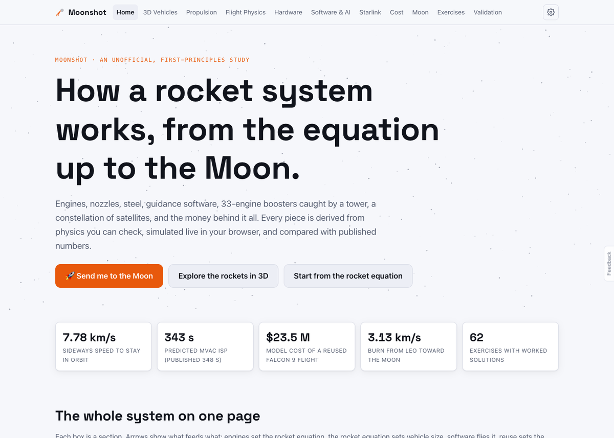
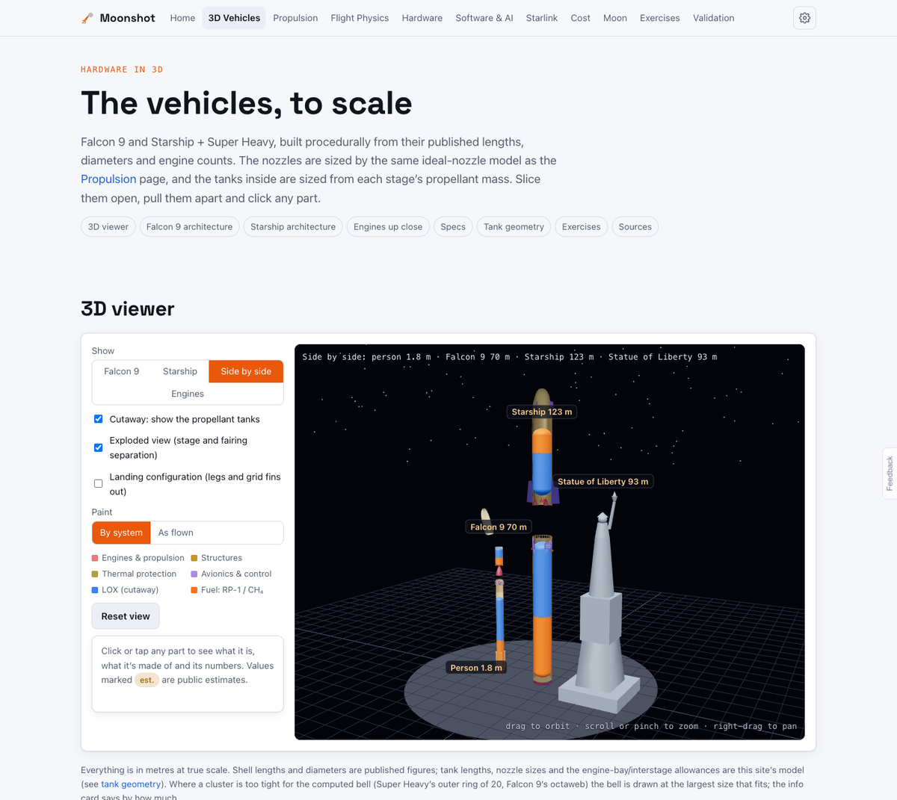
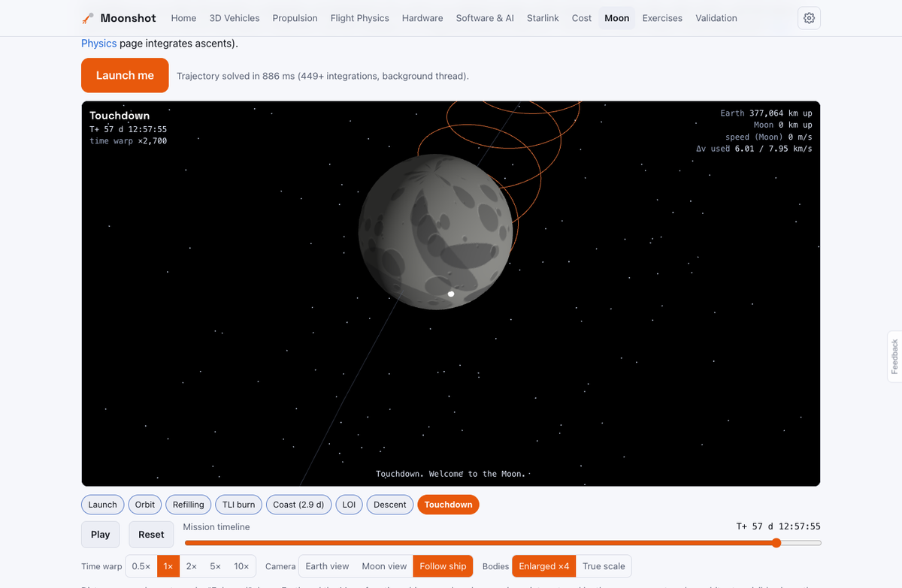
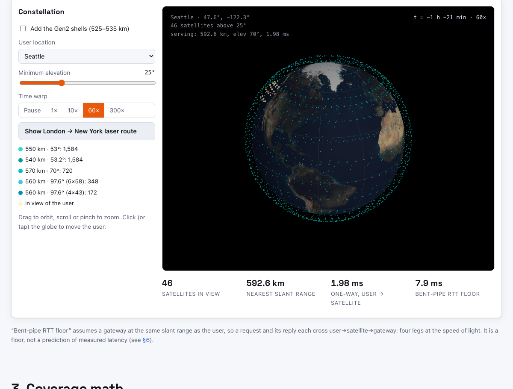
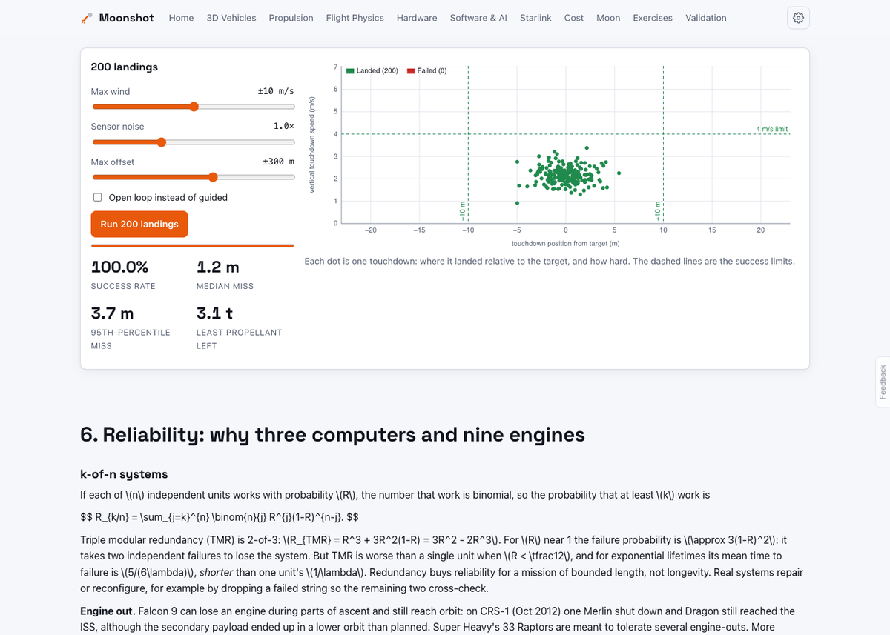
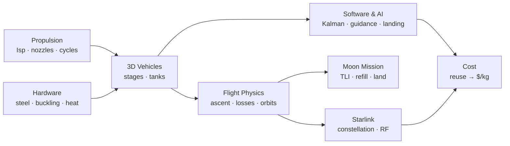

# Moonshot: How a Rocket Works

An unofficial, first-principles website that explains the whole SpaceX rocket system (engines, flight physics, hardware, flight software, Starlink and cost), simulates it live, flies you to the Moon, and checks every model against published figures.

| 3D vehicles, to scale, with cutaway tanks | Fly to the Moon: integrated Earth–Moon trajectory |
|---|---|
|  |  |
| **Starlink constellation and coverage** | **200 simulated booster landings** |
|  |  |

**Checked against the real thing.** Every row on the [Validation page](docs/images/validation.png) compares a model with a published number (Falcon 9 payload, Merlin/Raptor Isp, Apollo TLI/LOI, Starlink orbits and latency, and more), and `npm test` runs the same checks.

## Links

- [Setup, run and use](docs/INSTRUCTIONS.md)
- [System design](docs/SYSTEM-DESIGN.md)
- [What’s where](docs/FILE-STRUCTURE.md)
- [Project brief](SpaceX.md)

Not affiliated with, endorsed by, or sponsored by SpaceX. Figures marked “est.” are public estimates.
