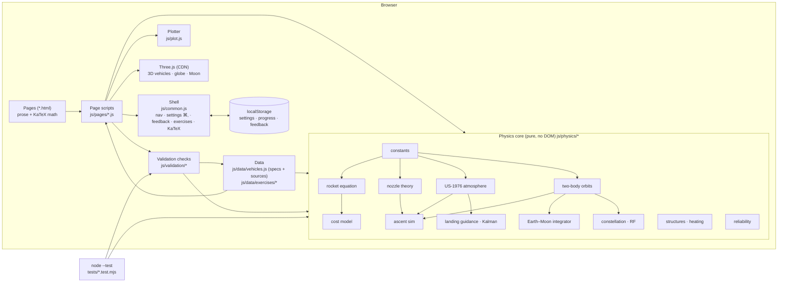

# Moonshot: System Design

Moonshot is a static website that explains how a modern reusable rocket system works (Falcon 9, Starship/Super Heavy, Starlink, flight software, cost) from first principles. It runs live simulations in the browser and checks every model against published figures. There is no server, no build step and no framework: plain HTML pages plus ES modules.

## Architecture

## Components

| Component | Job |
|---|---|
| `*.html` (11 pages) | Prose, derivations (KaTeX), symbol tables and the markup for interactive labs. One page per section. |
| `js/common.js` | Page shell injected on every page: header/nav, footer disclaimer, the **Settings** dialog (gear button or ⌘, / Ctrl+,), the **Feedback** tab, KaTeX loading/typesetting, the tag colour system, and the exercise widget (answer checking, hints, solutions, progress). |
| `js/plot.js` | Small dependency-free canvas line/scatter plotter: theme-aware, HiDPI, hover readout, log axes, reference lines. |
| `js/physics/constants.js` | SI constants (CODATA, IERS, JPL GM values). |
| `js/physics/rocket.js` | Tsiolkovsky equation, staging Δv, max-payload bisection, ideal-staging payload fraction. |
| `js/physics/engine.js` | Quasi-1-D isentropic nozzle flow: area–Mach, c\*, C_F, Isp vs ambient pressure, flow-separation flag, propellant properties, tank volumes. |
| `js/physics/atmosphere.js` | U.S. Standard Atmosphere 1976 (7 layers) plus an exponential tail. |
| `js/physics/orbit.js` | Vis-viva, Hohmann, plane change, state → elements, Kepler's equation, loss-free Δv to orbit. |
| `js/physics/ascent.js` | 2-D point-mass ascent: gravity turn, max-Q throttle bucket, ZEM/ZEV upper-stage insertion guidance, loss accounting, max-payload search. |
| `js/physics/structures.js` | Hoop stress / wall sizing, shell buckling, material yield vs temperature, Sutton–Graves heating, radiative equilibrium, Allen–Eggers entry. |
| `js/physics/cost.js` | Falcon 9 and Starship per-flight cost models, propellant cost, Wright learning curve, historical $/kg. |
| `js/physics/moon.js` | Earth–Moon dynamics (Earth-centred inertial frame, Moon on a circular orbit, indirect term), adaptive Dormand–Prince RK45, TLI targeting, LOI/descent/ascent Δv, HLS-style budget with tanker count. |
| `js/physics/starlink.js` | Walker-delta shells, circular propagation, J2 nodal precession, visibility/elevation, coverage geometry, phased-array factor, link budget, laser vs fibre latency, Hall-thruster orbit raising. |
| `js/physics/gnc.js` | Kalman filter, PID/TVC control, ZEM/ZEV powered-descent guidance, the deterministic booster-landing simulation and Monte Carlo. |
| `js/physics/reliability.js` | k-of-n reliability, TMR voting, engine-out probabilities. |
| `js/physics/tanks.js` | Pure tank geometry (cylinder + domes, ullage) behind the 3D cutaway. |
| `js/three/*` | Procedural Three.js models of Falcon 9, Starship/Super Heavy and engines (3D Vehicles page). `viewer.js` is loaded with a dynamic import, so the page's tables and calculator still work without WebGL. |
| `js/pages/moon-worker.js`, `js/pages/software-mc-worker.js` | Web Workers for the heavy searches (TLI targeting ~450 integrations; 200-landing Monte Carlo), each with a chunked main-thread fallback. |
| `js/data/vehicles.js` | **The single source of vehicle/engine facts**, each with a citation key and `est` markers for estimates. Models read inputs from here, and validation compares against here. |
| `js/data/exercises/*.js` | Exercises per section. Answers are **computed by the physics modules at load time**, so an exercise answer can never drift from the model. |
| `js/validation/*.js` | Model-vs-published checks per section, aggregated by `js/validation/index.js`. Rendered on `validation.html` and run by `tests/validation.test.mjs`. |
| `scripts/check-page.sh` | Headless-Chrome smoke test: prints console errors and saves a screenshot of a page. |

## Main flows

1. **Page load.** The HTML loads `js/common.js` (shell) and its own `js/pages/<page>.js`. The shell builds the nav and footer, applies saved settings (theme/motion), loads KaTeX from jsDelivr and typesets the page. The page script imports physics modules and wires sliders to models (`bindRange`) and models to plots (`linePlot`).
2. **Interactive lab.** Slider → `input` event → model function (pure) → stats/plots re-rendered. Heavy searches (max payload, TLI targeting, Monte Carlo) yield to the event loop between iterations so the page stays responsive.
3. **Exercise.** Typed answer → `parseAnswer` → `checkAnswer` (relative tolerance) → progress saved to `localStorage['moonshot.progress']` → the Exercises hub shows totals.
4. **Validation.** `validation.html` runs every section's `checks()` (yielding between sections), computes error vs tolerance and renders the table. `npm test` runs the identical functions in Node.
5. **Settings.** ⌘, or the gear opens the dialog. Changes write `localStorage['moonshot.settings']`, update `<html data-theme / data-motion>` and dispatch `moonshot:settings`; plots and 3D scenes re-read CSS colours, pixel-ratio caps and motion preferences.
6. **Feedback.** The side tab opens a dialog. Notes are stored in `localStorage['moonshot.feedback']` and can be copied or downloaded as JSON (there's no server to send them to).

## Where data lives

| Data | Location |
|---|---|
| Vehicle/engine specs and citations | `js/data/vehicles.js` (versioned with the code) |
| Exercises | `js/data/exercises/*.js` |
| Validation expectations (published figures) | inside each `js/validation/<section>.js` row, sourced to `SOURCES` keys or URLs |
| User settings, exercise progress, feedback | browser `localStorage` (per-browser, never leaves the machine) |
| Third-party code | CDN at runtime: KaTeX 0.16.11 and Three.js 0.169.0 (jsDelivr), Space Grotesk font (Google Fonts) |

## Key design decisions and trade-offs

- **Static site, no build.** Anyone can open it with any static server, and it deploys to GitHub Pages as-is. *Trade-off:* no bundling or minification; the CDN is needed for KaTeX/Three.js (pages still work without math typesetting if the CDN is down).
- **Pure physics modules shared by browser and Node.** The same functions drive the UI, the exercise answers, the validation page and the tests, so there's no duplicated maths to drift apart. *Trade-off:* modules can't touch the DOM, so pages need thin glue code.
- **Fit one, predict the rest.** The ideal-nozzle model needs an effective γ and molar mass. They are fitted to *one* engine per propellant (Merlin 1D, Raptor 2), and MVac, Raptor Vacuum and Raptor 3 are then genuine predictions (−1.4 %, −3.7 %, <1 %). *Trade-off:* the "effective" molar mass for methalox (23.6) is higher than the real chamber value (~22); it absorbs shifting-equilibrium and efficiency effects.
- **2-D ascent with closed-loop guidance** instead of a 3-D 6-DOF simulation: enough to show losses, max-Q and staging, and to predict Falcon 9 payload within ~10 %. *Trade-off:* no plane change, no dog-legs, no engine-out, no aerodynamic moments.
- **Honest tolerances.** Tight where the physics is exact (atmosphere tables, Kepler periods), loose where the inputs are estimates (stage dry masses, costs). Every row carries a note on what's missing.
- **Estimates labelled.** SpaceX doesn't publish costs, stage dry masses or many engine parameters. They are marked "est." in data and UI and cited to the best public source.
- **Colour by similarity.** Tags/categories use hue families (propulsion = reds/oranges, hardware = olive/yellow, economics = greens, communications = cyans, flight/orbits = blues, software = violets) with shades ≥ 12° apart, defined once in `TAGS` (`js/common.js`). They're rendered with OKLCH using theme-dependent lightness so they read in both light and dark mode.
- **localStorage only for per-viewer conveniences** (settings, progress, feedback drafts), always wrapped in try/catch so private mode still works.

## How it's tested

- `npm test`: Node's built-in test runner over `tests/*.test.mjs` (98 tests at the time of writing):
  - `core.test.mjs`: rocket equation round trips, staging, isentropic relations, C_F identities, USSA-1976 anchors and monotonicity, two-body relations (GEO radius, LEO→GEO Hohmann ≈ 3.9 km/s, Kepler), the ascent sim reaching orbit with sane events, and failing with an absurd payload.
  - Section tests (`moon`, `starlink`, `software`, `vehicles`): integrator energy conservation, TLI targeting, Walker geometry, J2 rates, Kalman convergence, deterministic landing, reliability identities, tank geometry.
  - `validation.test.mjs`: every model-vs-published row must sit inside its tolerance.
- `scripts/check-page.sh <page>` loads each page in headless Chrome, fails loudly on console errors and saves a screenshot for visual review (desktop 1400 px and phone 390 px widths). Use `REALTIME=8000` for pages with continuous 3D render loops.

## Known limits

- Stage dry masses, Starship figures and all costs are public estimates. The models are only as good as those inputs.
- The nozzle model is one-γ ideal flow with a fitted efficiency, not a chemical-equilibrium (CEA) calculation.
- The ascent is 2-D (equatorial-plane approximation at the launch latitude), with a simple gravity turn rather than an optimized trajectory, so it runs slightly optimistic.
- The Moon mission is planar, the Moon's orbit is circular, and the HLS profile is simplified to LEO → LLO → surface (the real Artemis HLS uses NRHO, and crew ride Orion).
- Starlink parameters (EIRP, G/T, bandwidth, satellite mass) are estimates from FCC filings and press; real beam scheduling and spectrum sharing aren't modelled.
- Flight-software content describes publicly stated architecture; internals are inferred and labelled as such. "AI" content separates public facts from industry practice.
- Feedback is stored locally only (no backend).
- The Validation page runs every check on the main thread; the Moon (TLI targeting) and Falcon 9 payload searches take ~1–2 s, during which rows fill in progressively.
- Headless-Chrome screenshots of URLs with `#anchors` render blank, and macOS clamps headless windows to ~500 px wide. Real phone-width checks use browser mobile emulation instead.
